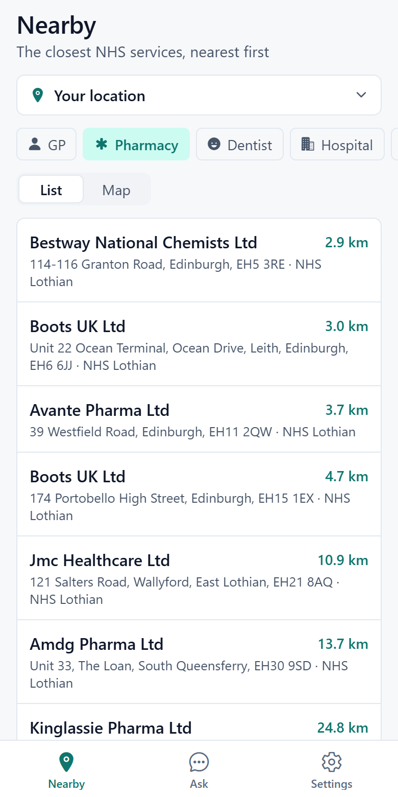
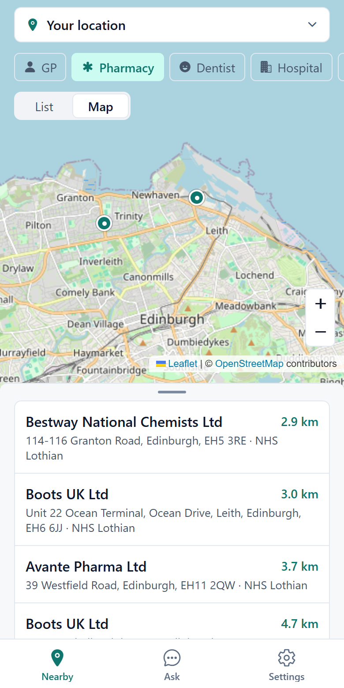
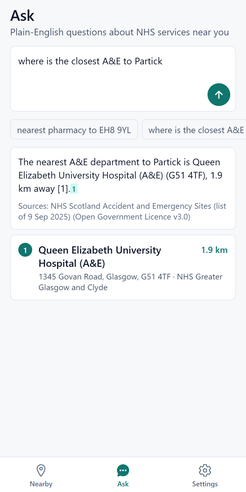
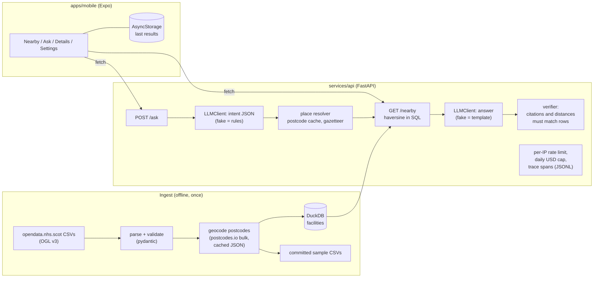

# scotland-nhs-nearby

Find the nearest GP, pharmacy, dentist, hospital or A&E in Scotland from NHS Scotland open data, on iOS, Android and the web from one TypeScript codebase, with a natural-language box that answers "nearest pharmacy to EH8 9YL" or "where is the closest A&E to Partick" and cites the rows it used.

| Nearby (list) | Nearby (map) | Ask |
|---|---|---|
|  |  |  |

Screenshots are the web export rendered by headless Playwright (`make screenshots`) against the committed sample data. No iOS or Android build was possible on the machine this was written on (no Java, Android SDK or Xcode), so the native paths are type-checked and unit-tested with mocks but have not been run on a device. See [Known limitations](#known-limitations).

## Problem

Someone new to a Scottish city does not know which GP, pharmacy, dentist or A&E is closest, or how to phrase the question. NHS Scotland publishes the lists as open data, but they carry postcodes rather than coordinates, and nothing turns them into "closest to me". This project does that, and keeps the natural-language layer honest: the model only turns a question into a structured query and then phrases an answer about rows the database returned. It never supplies facts.

## Architecture



Layout:

```
apps/mobile/       Expo + Expo Router app (iOS, Android, web); Jest tests; Maestro flows in .maestro/
services/api/      FastAPI + DuckDB backend, uv project (src/nhs_nearby, tests, scripts)
data/              SOURCES.md, geocode_cache.json, gazetteer.json, sample/*.csv (raw/ is gitignored)
evals/golden/      40 labelled questions
reports/           generated JSON and results.md
docs/              screenshots
```

## How to run

You need Python 3.12 via [uv](https://docs.astral.sh/uv/), and Node 22 or newer. No API key is needed: with no key set the backend uses a deterministic rule-based provider (`LLM_PROVIDER=fake`).

```bash
# Backend: offline demo against the committed sample (also what `make demo` runs)
cd services/api && uv sync
LLM_PROVIDER=fake uv run python scripts/demo.py

# Tests, lint, eval
uv run pytest
uv run ruff check src tests scripts && uv run ruff format --check src tests scripts
uv run python scripts/eval.py --gate ../../evals.yaml

# API server (uses data/nhs.duckdb when it exists, else the committed sample)
uv run uvicorn nhs_nearby.api:app_factory --factory --port 8000

# Web app, in another terminal
cd apps/mobile && npm ci
npm test && npm run lint && npm run typecheck
npx expo start --web            # or: npx expo export --platform web
```

The same steps are Makefile targets (`setup`, `test`, `lint`, `demo`, `serve`, `app`, `eval`, `bench`, `web-build`, `results`, `screenshots`; each has a one-line comment in the Makefile). On Windows, run the commands above directly if `make` is not installed.

**Full dataset.** The committed sample is 230 rows, so "nearest" answers from the sample can differ from the real nearest facility. To use all NHS Scotland rows:

```bash
cd services/api
uv run nhs-ingest download     # five CSVs into data/raw/ (gitignored)
uv run nhs-ingest build --report ../../reports/ingest.json   # data/nhs.duckdb + refreshed sample
```

`data/geocode_cache.json` already holds every postcode, so `build` needs no network once the CSVs are downloaded. Set `USE_SAMPLE=true` to force the sample again.

**Real LLM.** Copy `.env.example` to `.env`, set `OPENROUTER_API_KEY` (or `ANTHROPIC_API_KEY` / `OPENAI_API_KEY`) and leave `LLM_PROVIDER` empty. Models are OpenRouter slugs (`anthropic/claude-sonnet-5.5` by default). Nothing in this repo has been run against a real model.

**Phone or emulator.** Set `EXPO_PUBLIC_API_URL` to an address the device can reach (the Android emulator reaches the host at `http://10.0.2.2:8000`, a physical phone needs your machine's LAN address), or change it in the Settings screen. Maestro flows in `apps/mobile/.maestro/` cover the happy path, the Ask screen and the postcode fallback (`maestro test apps/mobile/.maestro/nearby.yaml`); they are not run in CI.

## API

| Endpoint | Purpose |
|---|---|
| `GET /nearby?lat&lon&category&limit` | nearest rows by haversine distance: name, address, postcode, distance_km, category, health board, source dataset |
| `POST /ask` `{question, lat?, lon?}` | intent -> place -> rows -> grounded answer with `[n]` citations; fixed refusal for out-of-scope questions |
| `GET /resolve?q=` | postcode or place name to coordinates (used by the postcode fallback) |
| `GET /facility/{id}`, `GET /meta`, `GET /health` | details, row counts and provider, liveness |

Categories are `gp`, `pharmacy`, `dentist`, `hospital`, `ae`. Every request passes a per-IP token bucket (429 with `Retry-After`) and `/ask` stops when the daily USD cap from settings is used up (429). Every `/ask` writes spans (`ask`, `parse_intent`, `resolve_place`, `nearby_query`, `compose_answer`, `verify`) to `TRACE_PATH` in the shared span schema; client addresses are stored as a short hash.

## Results

Produced by `scripts/eval.py`, `scripts/bench.py`, `nhs-ingest build` and `scripts/bundle_size.py`, then assembled by `scripts/make_results.py` (which also writes `reports/results.md`). Nothing below is typed by hand. Intent and answer numbers come from the rule-based `fake-provider`, not a language model; they show the plumbing and the verifier work, and say nothing about real-model quality.

<!-- results:start -->
### Golden set (40 queries, `fake-provider`, commit `5b52b59`)

| Metric | Value | Provider |
|---|---|---|
| Intent accuracy (category, place, limit, scope) | 92.5% | fake-provider |
| Top-1 hit rate (nearest facility is first) | 94.1% | fake-provider |
| Refusal accuracy (refuse exactly the out-of-scope) | 95.0% | fake-provider |
| Grounded answers (citations and distances verified) | 100.0% | fake-provider |
| Unknown place returns no rows | 100.0% | fake-provider |
| Task success (every check on the case passes) | 92.5% | fake-provider |

Failing cases (kept in the set on purpose):

- `g-0030` Is there a hospital with an A&E near Dumfries?
- `g-0031` closest place to get my teeth checked in Dundee
- `g-0032` where can I get my prescription refilled near Leith

### `GET /nearby` latency (Windows AMD64, Python 3.12.13; in-process ASGI test client; no network hop)

| Database | Rows | p50 (HTTP) | p95 (HTTP) | p50 (SQL only) | p95 (SQL only) |
|---|---|---|---|---|---|
| sample (committed CSVs, in memory) | 230 | 10.957 ms | 15.557 ms | 4.659 ms | 7.372 ms |
| full (data/nhs.duckdb) | 3442 | 17.322 ms | 25.952 ms | 10.393 ms | 17.152 ms |

### Dataset rows per category

| Category | Parsed from source | Loaded (geocoded, Scottish) | Dropped | In committed sample |
|---|---|---|---|---|
| GP practices | 879 | 876 | 3 | 55 |
| Pharmacies | 1343 | 1324 | 19 | 55 |
| Dental practices | 989 | 976 | 13 | 50 |
| Hospitals | 244 | 236 | 8 | 40 |
| A&E departments | 30 | 30 | 0 | 30 |
| **Total** | 3485 | 3442 | 43 | 230 |

2764 unique postcodes geocoded once at ingest (cached in `data/geocode_cache.json`).

### Web bundle size (`expo export --platform web`)

| Artifact | Size |
|---|---|
| Entry JavaScript (minified) | 1090.2 KB (285.7 KB gzip) |
| Whole `dist/` directory | 1385.4 KB across 31 files |

<!-- results:end -->

How to read the golden set: questions and intent labels are hand-written; the expected top-1 facility is computed by an exhaustive Python haversine over the sample from the resolved place, independent of the SQL and of the intent parser. Six questions (tagged `natural`) were written after the rule parser was finished, and three of them fail: a question with no category keyword, the word "prescription" tripping the advice filter, and an "is there a hospital with an A&E" yes/no question where the parser returns three rows and the label expects one. They stay in the set.

## Known limitations

- **Sample versus full data.** Demo and test answers come from a 230-row sample. Only a full `nhs-ingest build` gives true nearest results.
- **No real-model numbers.** There is no API key on the build machine. The fake provider is a regex parser plus a template, so a 90-100% score here is expected and is not evidence about Sonnet-class models. The gate in `evals.yaml` should be re-tuned after a real run.
- **Native apps untested on devices.** `react-native-maps`, `expo-location` and the iOS/Android deep links are exercised only through types, Jest mocks and an Expo web export. The web build is the only target run end to end.
- **Straight-line distance.** Distances are great-circle, not walking or driving time, and ignore opening hours, which the open data does not contain. The details screen tells users to check hours.
- **Postcodes outside the cache.** The cache holds postcodes that back an NHS site. Any other postcode falls back to the centroid of cached postcodes in the same district (labelled "approximate") unless `LIVE_GEOCODE=true` allows a live postcodes.io lookup.
- **Pharmacy names are contractor names** in the source ("Boots UK Ltd"); the address identifies the branch. The hospital list includes small and non-acute sites. The A&E list is dated 9 Sep 2025.
- **Hand-written gazetteer.** About 110 towns and city districts with approximate centres; places outside it are reported as not found rather than guessed.
- **Single-process limits.** Rate limiter and daily spend counter live in memory and reset on restart; behind several workers they need a shared store.
- **Cost table.** `pricing.json` prices for the 5.5-generation models are assumed equal to the previous generation of the same tier and must be checked before relying on cost figures.
- This is not an official NHS service and gives no medical advice.

## Design notes

**Why DuckDB over PostGIS for this size?** The whole dataset is about 3,500 rows. A nearest-N query is a scan with a haversine expression and an `ORDER BY ... LIMIT`, which takes roughly ten milliseconds on the full table (see the latency table). DuckDB is an embedded file, so there is no server to run, the committed CSV sample loads into memory for tests, and the same SQL runs in CI. PostGIS would add an index (`ST_DWithin`, KNN `<->`), real geography types and concurrent writers, none of which this read-only, tiny, batch-built table needs. I would switch when the table grows to millions of rows or when the data has to be updated live, and the `Database` class is the only place the SQL lives.

**Why geocode at ingest, not at query time?** The source files only have postcodes. Resolving them per request would put a third-party API on the hot path of every search, spend rate limit on the same few thousand postcodes, and make results vary with an external service. Geocoding once (2,764 unique postcodes in 28 bulk requests) turns the dynamic problem into static data, makes ingest reproducible offline from a committed cache, and leaves `/nearby` as a pure database query. The cost is staleness: new postcodes need a re-run of ingest, and terminated postcodes drop rows (43 of 3,485, reported per category).

**Why intent parsing plus a grounded answer instead of free-text generation?** A model asked "nearest pharmacy to Leith" will happily invent a plausible pharmacy. Here the model does two narrow jobs: map the question to `{category, place, limit}` (validated against a schema, with the rule parser as fallback for malformed output) and phrase an answer about numbered rows the database already chose. A verifier rejects any answer whose citations point outside the rows, that cites nothing, or that states a distance not in the rows, and swaps in a template answer. Medical or off-topic questions get a fixed refusal pointing to NHS 24, decided from the structured intent rather than by hoping the answering prompt holds. The trade-off is flexibility: questions that do not reduce to category, place and limit are refused, which is the right failure for a health directory.

**What breaks when postcodes.io is down?** Ingest is unaffected once the cache is committed. At runtime the default configuration never calls postcodes.io: typed postcodes resolve from the cache, else from the district centroid of cached postcodes, else the gazetteer. With `LIVE_GEOCODE=true` a lookup is attempted for unknown postcodes with a 5 second timeout, and any network or parse failure returns "not found" and falls through to the district centroid instead of raising. Typed postcodes in the app go through `/resolve`, so a down API shows a clear message and the last good results stay visible with a "cached" badge. Not covered: nothing refreshes the cache automatically, so a new postcode in a future NHS release is dropped until ingest is re-run.

**How does the same code ship to three platforms?** One Expo Router app with file-based routes. Platform differences are isolated at module boundaries rather than `if` statements in screens: `MapPane.native.tsx` (react-native-maps) and `MapPane.web.tsx` (react-leaflet with OpenStreetMap tiles and attribution) share one props type, and Metro picks the right file per platform, so the web bundle never imports the native map. `directionsUrl` builds an Apple Maps, `geo:` or Google Maps link by platform, `expo-location` covers GPS on all three with a postcode fallback when permission is denied, and AsyncStorage keeps the last results (it is `localStorage` on the web). The CI build check is `expo export --platform web`; iOS and Android builds need EAS or a local SDK and are not part of this repo's CI.

## Data and licences

NHS Scotland datasets are published under the Open Government Licence v3.0. Sources, resource URLs, row counts and download dates are in [`data/SOURCES.md`](data/SOURCES.md). Postcodes are geocoded with [postcodes.io](https://postcodes.io). Map tiles are OpenStreetMap, copyright OpenStreetMap contributors (ODbL), and the attribution is shown on the map. Code is MIT licensed.
